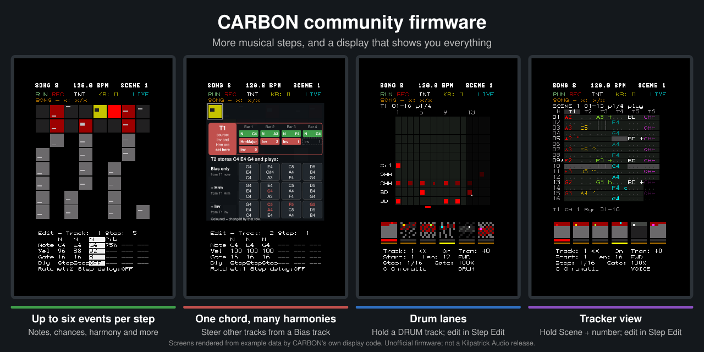

# CARBON community firmware



**New here?** The illustrated [user guide](carbon-fw-2026-johanw.org) shows
what the firmware adds, with diagrams of Step Edit, step events and Bias
harmony. Screens are rendered from example data by CARBON's display code.

**Local candidate:** `1.38-jwk-sys1`, with Arp Speed Chord, Humanize and
[menu overviews](CLOCK-HELP.org): hold Clock, Arp, MIDI or Tonality;
Motion Start selects and Length/Value edits. Snapshot/Recall stay status-only.
See [ARP-CHORD.org](ARP-CHORD.org) for voicing and transition rules, and
[HUMANIZE.org](HUMANIZE.org) for velocity, gate and probabilistic late onset.
Ordinary arp uses velocity/lateness only; generated Chord is not humanized.
The published releases below do not contain these features.

This branch also includes the previously tested one-level song undo.
See [UNDO.org](UNDO.org) for controls, scope and pending hardware checks.
This feature is not in the published 1.37 RC1 described below.

Unofficial firmware for the Kilpatrick Audio CARBON hardware sequencer.
Not an official Kilpatrick Audio release. Installation is at your own risk.

**Community release candidate:** `community-1.37-rc1`, System identity
`1.37-jwk-rc1`. See the [fork releases page](https://github.com/johanwk/CARBON/releases)
for the binary, checksum and build record. This prerelease invites wider
real-world testing; it is not a claim of exhaustive production validation.
Official updater binaries do not contain these community additions.

## What it adds

Program Change per step/scene; Euclidean density/rotation and unusual bar
divisions; ordered conditional events including scene-mask gates; Bias-routed internal controls (CCi);
roots and Hrm harmony; Inv/Compact voicing; individual note delays; curved
CV glide and synth-dependent MIDI portamento; current-state pitch/delay grid;
manual performance timing/pitch protection with next-bar target readouts;
whole-song RAM snapshots; backup, JSON and MIDI import tools.

Use the [official CARBON product/manual page](https://www.kilpatrickaudio.com/?p=carbon)
for ordinary operation, connections and original features. The
[community user guide](carbon-fw-2026-johanw.org) documents the additions,
controls and examples rather than replacing the official manual.

## Hardware and tested setup

Target: original CARBON with STM32F407VE and factory MIDI bootloader; release
application at 0x08020000. Not a build for other sequencers or modified boards.
Recorded practical use is on one user's CARBON (LCD A), with macOS/CoreMIDI,
Bitwig, MIDI and CV/gate, including Moog Mother-32 Program Change/CV use.
Both LCD layouts have host UI tests, not equivalent physical coverage.
Do not assume every firmware feature was tested with every device.

## Install a release binary safely

1. **Back up saved songs before installation and before saving migrated songs.**
   [Song-tool instructions](tools/carbon-backup/README.md) include raw bank backup.
   Copy archives somewhere safe. They exclude firmware, unsaved RAM, global
   configuration and editable preset-pattern definitions.
2. Obtain the specific community release `main.bin`, its SHA256/build record
   and corresponding source. Verify with `shasum -a 256 main.bin` (macOS) or
   `sha256sum main.bin` (Linux); the checksum must match that release.
3. Install [dfu-util](https://dfu-util.sourceforge.net/). On macOS with Homebrew:
   `brew install dfu-util`; on Debian/Ubuntu: `sudo apt install dfu-util`.
   Fedora: `sudo dnf install dfu-util`. Windows: extract the Windows package
   linked from the dfu-util website. In DFU mode, use
   [Zadig](https://zadig.akeo.ie/) to install WinUSB for **STM32 BOOTLOADER,
   USB ID 0483:df11** only; do not replace CARBON's normal MIDI driver.
   Windows/Linux instructions have not been CARBON-tested in this project.
4. Stop playback, disconnect sensitive outputs if appropriate, and use reliable
   power and USB. Enter STM32 ROM DFU by holding the power button while applying
   power. Run `dfu-util -l`; confirm `0483:df11`, alt 0, Internal Flash.
   The listing may start at 0x08000000; that is NOT the application address.
5. From the directory containing the verified binary, run exactly:

```sh
dfu-util -d 0483:df11 -a 0 \
  --dfuse-address 0x08020000:leave \
  -D main.bin
```

On Linux, prefix dfu-util commands with `sudo` if USB access is denied.
On Windows PowerShell, place main.bin beside the extracted dfu-util.exe:

```powershell
Get-FileHash .\main.bin -Algorithm SHA256
.\dfu-util.exe -l
.\dfu-util.exe -d 0483:df11 -a 0 --dfuse-address 0x08020000:leave -D .\main.bin
```

Confirm the same USB ID/alt setting and release checksum before flashing.

**0x08020000 is essential: it preserves the factory bootloader. Never use
stock `dfu.sh`, development images, mass erase, or 0x08000000 for this release.**
No JTAG programmer is needed for this procedure. KAUpdate/WebMIDI installation
of this unofficial binary has not been verified.

6. Wait for successful completion and restart. Check the System identity, then
   boot/playback, MIDI, CV/gate and a disposable save/reload before performance
   use. See the [release checklist](RELEASE-CHECKLIST.org).

### Recovery

If installation fails, keep backups intact, re-enter ROM DFU, check USB/power
and the image checksum/address, then reflash the same known-good release
application at 0x08020000. Do not erase or replace the bootloader as a shortcut.
A firmware reflash does not repair a partially replaced saved song. Retain
recovery archives and inspect/plan a supported song restore before retrying.
Returning to older firmware requires its matching application and pre-upgrade
songs; faithful downgrade of 1.37 songs is not supported.

## Everyday starting points

- Scn: select a Scn slot in Step Edit, then buttons 1--6 toggle allowed scenes
  with matching LEDs. See [scene gates](SCENE-GATES.org).
- Shift+Pattern: density; Shift+Transpose: Euclidean rotation in normal mode.
- Clock menu: Perform Grid (Straight) and Perform Pitch (Octaves/Octaves+5ths).
  These protect manual gestures, not all automation. Running edits apply next
  4/4 bar; turning back cancels. Stop/reset/scene/song boundaries cancel edits.
- Hold Clock first, press Record: capture RAM snapshot. Clock then Load: recall
  next bar, or immediately stopped. Either release order works. Clock alone
  opens its menu on release; Shift+Clock tap tempo remains on press.
- Step Edit: select a slot with Shift+Motion Start; Shift+Transpose selects its
  event type. See the guide for Hrm, Inv, Gli, CCi and note-delay examples.

## Compatibility and limitations

- New events/delays are not understood by older firmware. Keep pre-upgrade
  originals; unchanged 20480-byte song size does not imply compatibility.
- Host upload does not reload RAM: **LOAD afterward; do not save stale RAM.**
  Song replacement is not atomic across five sectors.
- Local Gli applies to later Note slots on its step. Persistent CCi34/35 are
  transient Bias-target overrides, including generated arp output. MIDI glide
  depends on the receiving synth; CV glide requires mono pitch groups.
- Grid strokes preview current state, not future probability or automation.
- Snapshot is one volatile RAM copy, not a backup/undo history; no external
  synth state, global patterns or PRNG rewind. Load/clear/power-off invalidates it.
- Finite queues and MIDI bandwidth remain limits; arbitrary overload is not
  lossless. Worst-case interrupt time and stack headroom are unmeasured.
- The maintainer reports no failures in current practical testing. Coverage
  is not exhaustive: busy-load measurements and a hardware round-trip of the
  new 1.37 simple-upload workflow remain useful community test targets.

## Build and contribute

See [BUILDING.org](BUILDING.org), [song tools](tools/carbon-backup/README.md),
[release notes](RELEASE-NOTES.org) and [verification checklist](RELEASE-CHECKLIST.org).
Report reproducible community-build issues to the fork with identity, route,
clock source and minimal steps; do not attach private songs without consent.
Keep fixes focused; this release freezes the musical feature set. Never upload
commercial MIDI files or personal backups as test fixtures without rights.

This cumulative release includes PR #10/#11/#12 plus subsequent work. Those
narrower PR branches remain separate and unchanged. This prerelease does not
depend on those submissions being reviewed or merged.

## Licensing / using code in your own projects

__THIS CODE IS GPL LICENSED UNLESS SPECIFIED OTHERWISE__

If you plan to use this code in your own projects you MUST understand the
requirements of each source file you use. Some vendor-supplied files have 
special license restrictions. All other source files are GPL licensed. You
must understand what this means, especially in regards to commercial projects.

In short: If you use any (non-ST supplied) code in your project, your entire
project must be licensed and released under the GPL. If you don't agree with
this please leave now and don't refer to or use any of the code here.

## Developing on CARBON Hardware

You bought a CARBON and want to hack it? Yay!

Please note that any modification you do to CARBON whether hardware or software
is entirely at your own risk. It *IS* possible to damage hardware with wrong
firmware, so please be careful and read any I/O code carefully before making
changes. The hardware is not open source but there are clear APIs for everything
related to the physical device so that should be easy enough.

If you want to try out stuff, you will most likely need to use a JTAG interface
to program and debug CARBON. The J-Link or ST-Link are both decent and support the
industry-standard 20 pin (10x2) ARM JTAG connector. You will find an unpopulated
connector on the corner of the mainboard inside CARBON labeled X10. Solder a pin
header on here and connect it to your JTAG programmer. The rest should be obvious
from reading the various scripts included with the code.

## Reporting bugs

Please open an issue for each reproducible bug. Interesting and
easily integrated pull requests will be considered for official releases.
Feature requests should not be added one at a time. Make sure your request
would make sense for most users, and keeps with the idea of the original
design. Small enhancements are considered, but major redesigns are really
beyond the scope of what we can consider.

__IMPORTANT: Do not place multiple feature / bug requests in the same issue!__

## Changelog:

For changes please see the individual release notes.
  

