#+title: CARBON community firmware - user guide
#+author: Johan W. Kluwer
#+options: ^:nil -:nil toc:2

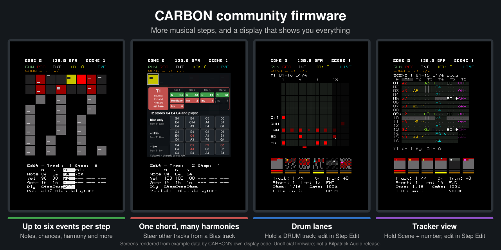

* Introduction

This is unofficial community firmware for the Kilpatrick Audio CARBON
sequencer. It keeps everything the original firmware does and adds more
musical step events, harmony control, performance tools and a display that
shows much more of what is going on. It is not an official Kilpatrick Audio
release and has no manufacturer support.

This guide describes the additions. For ordinary operation, connections and
original features, use the [[https://www.kilpatrickaudio.com/?p=carbon][official CARBON manual]]. For installation,
recovery and release status, start with the [[file:README.md][README]].

All screen images in this guide are rendered on a computer by CARBON's own
display code from example data. They show exactly what the display draws,
but they are not photographs of a running session. Panels drawn over the
step grid in some diagrams are explanations for this guide; CARBON does not
show them.

** At a glance

- *Step events*: besides notes and MIDI CC, a step can hold Program Change,
  conditions (scene, probability, Euclidean loops, previous result),
  harmony (scale and root), chord inversion, glide and internal control of
  other tracks.
- *Bias tracks that steer harmony*: one track can change scale, root and
  chord voicing of the tracks that follow it.
- *Overviews*: hold a menu button for a full-page menu; hold a track or
  Scene + number to see settings across all scenes or all tracks.
- *Expanded Step Edit*: all note values of a step visible at once.
- *Timing*: Euclidean density and rotation, bar-relative step lengths
  (1/3, 1/5, ...), individual note delays.
- *More music in 64 steps*: with individual note delays, one step can hold
  several notes at different times. A pattern can carry far more musical
  detail than 64 steps suggest, so longer pieces fit on CARBON than you
  might expect.
- *Performance*: next-bar timing and pitch protection, a whole-song RAM
  snapshot, one-level undo and Humanize.
- *Arpeggiator Chord mode* for simultaneous generated chords.
- *Host tools* for backup, JSON editing and MIDI import.

No original feature has been removed. Original step-length entries, arp
speeds, Note and CC events, Bias Track transposition and track Program A/B
settings behave as before.

* Before you start

** Install

Install a specifically identified build after checking its release notes.
The [[file:README.md][README]] has the full, safe procedure: back up songs, verify the
checksum, then flash with =dfu-util= at address =0x08020000=, which
preserves CARBON's MIDI bootloader. Never use the stock =dfu.sh= or address
=0x08000000=. [[file:BUILDING.org][BUILDING.org]] explains how to build the firmware yourself.

After flashing, check the version under SYS, then playback, MIDI, CV/gate
and a disposable save/reload before using CARBON in performance.

** Back up, and do not downgrade songs

Back up saved songs before installing and before saving songs with new
firmware. Songs keep their size (20480 bytes), but songs using the new
events or settings cannot be played faithfully on older firmware: it may
ignore new events or suppress later events on a step. Keep your
pre-upgrade originals for use with older firmware. See
[[*Compatibility and storage][Compatibility and storage]].

** Note names in a DAW

CARBON names notes with middle C (MIDI note 60) as =C4=. Some DAWs,
including Bitwig, call the same note =C3=. Only the name differs: the
MIDI note number, and so the pitch, is identical. Every note reads one
octave lower by name in such a DAW (=E4= on CARBON appears as =E3=). Check
the note number in the DAW's MIDI monitor if in doubt.

* The display

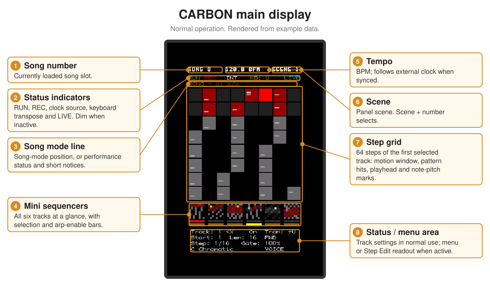

** Pitch strokes in the step grid

Step cells carry short horizontal strokes, one per note. Higher strokes
mean higher pitches; strokes move right with note delay. Their width is
fixed and does not show note length. All cells share one pitch range of at
least two octaves, so this is a contour view, not an exact pitch ruler.

The strokes show current pitches: Bias offsets, keyboard and CCi transpose,
harmony (scale and root) and inversion are all taken into account. They do
not predict the future: every stored note is drawn, including notes a
condition may skip. Arp tracks show no strokes, since the arp output is not
predictable from its input. Step Edit keeps the strokes, drawn dark on
bright selected cells.

** Status line additions

- When a track's Euclidean density is below 100%, the song line shows its
  =length:hits:rotation=, e.g. =16:7:3=. The hit count is the number of
  active positions, not necessarily sounding notes.
- =STR= or =PIT= at the start shows performance protection is on; =*=
  means a change is waiting for the next bar (see [[*Performance tools][Performance tools]]).
- The track readout shows waiting values with =>=, e.g. =Tran:>+7=.
- Short notices (Snapshot captured, Undo next bar, ...) appear here for
  two seconds.

* Overviews

Several long-press gestures open a full-page view over the step grid. All
use an 800 ms hold. In every overview, *Clock closes the view*. Pressing
another button closes it and then performs that button's normal action.

** Menu overviews

Hold *Clock*, *Arp*, *MIDI* or *Tonality* for 800 ms; for the System menu,
hold *Shift first, then MIDI*. The whole menu appears as a list:

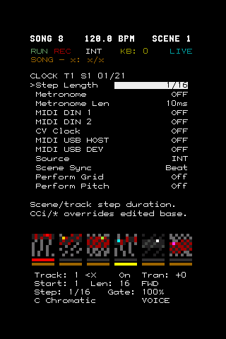

- *Motion Start* selects a row; *Length/Value* edits it. Other encoders do
  nothing.
- Up to twelve rows are visible; the list scrolls. Two help lines describe
  the selected row.
- Edits are real and take effect immediately, exactly as in the normal menu
  (closing is not Undo). MIDI port/channel edits can release notes, Program
  edits can send Program Changes, and System CV settings change physical
  outputs: use a meter when calibrating.
- Status-only rows (Clock Snapshot and Recall, SYS version) cannot be
  edited here.
- Clock's Step Length row shows an active CCi override (=CCi=) and a value
  waiting for the next bar (=>bar=). While a CCi override is active, an
  =Edit:= line shows the stored value you are editing.

Short presses keep their normal meaning. To tell a press from a hold,
unshifted Arp, MIDI and Tonality now act when you *release* them. A long
Arp hold does not toggle the arp. Shifted presses (Shift+Arp, Shift+MIDI,
Shift+Tonality) still act immediately.

Menu sizes: Clock 21 rows, Arp 3, MIDI 22, Tonality 14, SYS 20. More
detail: [[file:CLOCK-HELP.org][menu overview controls]].

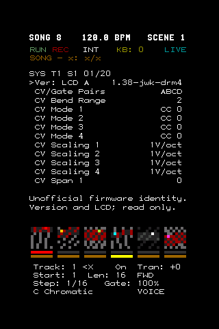

** Track overview: one track across six scenes

Hold a *track button* alone for 800 ms. The track is selected immediately,
as always; the hold adds a read-only view of that track in all six scenes.

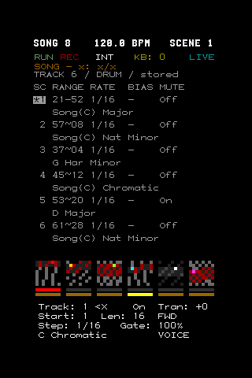

- Each scene has two lines: motion range, step length, Bias Track and mute;
  then root and scale.
- =RANGE= is the first and last step of the motion window. A tilde, e.g.
  =57~08=, means the window wraps from step 64 to step 1.
- =Song(C)= means the scene uses the song root, C. Roots are shared by all
  tracks in a scene.
- The current scene is highlighted. The view shows stored settings, not
  temporary CCi or harmony overrides or values waiting for the next bar.
- All encoders are inactive. Read-only views use grey text.

The hold is not armed during Shift (mute), Scene (select/copy), multi-track
selection or Scn editing, so those gestures are unchanged.

** Scene overview: one scene across six tracks

Hold *Scene first*, then hold a *number* for 800 ms. The number selects
that scene immediately, as always (Scene Sync still decides when playback
changes). The hold then shows the scene's settings for all six tracks:

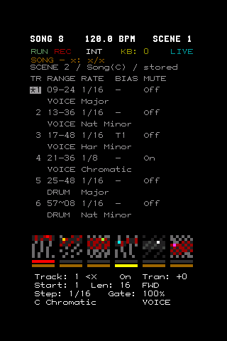

- The heading shows the scene's root. Each track has two lines: range,
  step length, Bias Track and mute; then VOICE/DRUM and scale.
- Selected tracks are highlighted. The view stays on the chosen scene even
  while playback is still waiting to switch.
- Shift+Scene+number still copies a scene. Pressing the number before Scene
  does not open this view.

* Step Edit

Step Edit works as in the original firmware, with more event types and an
expanded display.

** The expanded view

While in Step Edit, *hold Step Edit for 800 ms* to switch between the
compact and expanded display. The choice is remembered until power-off.
The expanded view uses the space of the six mini sequencers to show every
note value of the step at once:

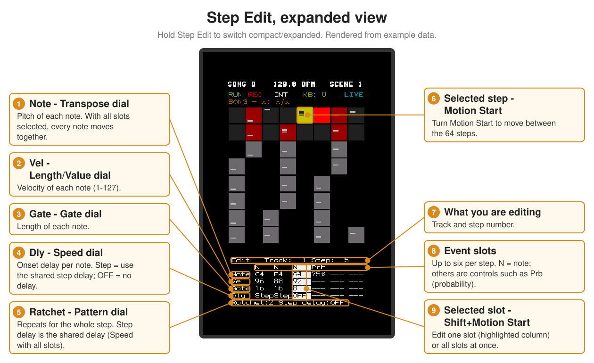

A short press of Step Edit within Step Edit replays the step (on release).
Holding never plays notes or changes the song. Shift+Step Edit still opens
Pattern Edit.

** Dials

| Control              | Edits                                                 |
|----------------------+-------------------------------------------------------|
| Motion Start         | Selected step                                         |
| Shift + Motion Start | Selected slot, or all slots                           |
| Transpose            | Note pitch; first value of other event types          |
| Shift + Transpose    | Event type of the selected slot                       |
| Length/Value         | Note velocity; second value of other event types      |
| Gate                 | Note length                                           |
| Speed                | Note delay (one slot) or shared step delay (all)      |
| Pattern              | Ratchet: repeats for the whole step, 1 to 8           |
| Shift + Record       | Clear the selected slot, or the whole step            |

Turning Transpose, Length/Value or Gate on an empty step or empty selected
slot creates a note; with Shift held it creates a CC instead.

With *all slots* selected, Transpose moves note pitches only: conditions,
CCs and other events keep their values. To edit those, select their slot.

Turning Pattern (ratchet) does not play the step, because a single preview
hit would misrepresent the repeats. Normal playback plays the repeats.

** Gate lengths

The Gate row shows note length as a musical value: the longest value that
fits within the stored length.

| Shown | Length            | Shown | Length                  |
|-------+-------------------+-------+-------------------------|
| 64    | 1/64 note or less | 8     | eighth                  |
| 64.   | dotted 1/64       | 8.    | dotted eighth           |
| 32    | 1/32              | q     | quarter                 |
| 32.   | dotted 1/32       | q.    | dotted quarter          |
| 16    | sixteenth         | h     | half                    |
| 16.   | dotted sixteenth  | h.    | dotted half             |
|       |                   | w     | whole                   |
|       |                   | w+    | two whole notes or more |

A dot means one and a half times the plain value. New notes get half the
track's step length. Track Gate and Humanize can change the played length.

** Note delays

With *all slots* selected, Speed edits the shared step delay. With *one
note slot* selected, Speed edits that note's own delay:

- =Step= means the note uses the shared step delay.
- =OFF= means no delay for this note.
- A note's own delay replaces the shared delay; it is not added to it.

*More music per step.* Because each note in a step can have its own delay,
one step can hold up to six notes at different moments within it: a
triplet, a run of sixteenths, a short phrase. With longer step lengths, a
single step can cover a whole beat or bar of detailed music. 64 steps can
therefore hold much longer and more detailed pieces than "one note per
step" suggests.

Besides absolute delays, there are delays relative to the current step
length: =s1/8=, =s1/4=, =s1/3=, =s1/2=, =s2/3=, =s3/4= and =s7/8=.
Example: on a quarter-note step, three notes at =OFF=, =s1/3= and =s2/3=
play as an even triplet. Ratchets delay the whole train of repeats.
Stop cancels delayed notes that have not played yet. The arp ignores note
delays, and recording does not capture timing within a step.

* Step events

** Anatomy of a step

Each step holds up to six *slots*. Each slot holds one *event*. Slots are
read *left to right*, and the order matters:

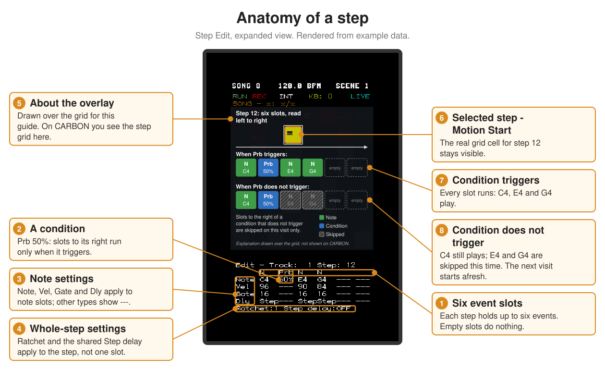

Ratchet and the shared step delay belong to the whole step, not to a slot.

** Four families of events

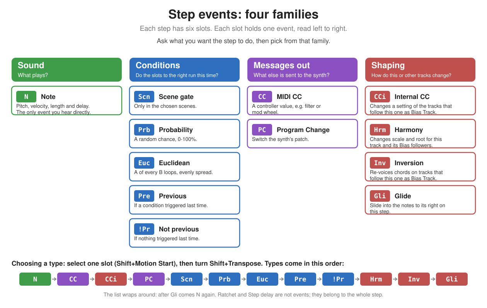

Choose a type by selecting one slot (Shift+Motion Start) and turning
Shift+Transpose. The order is:

=N -> CC -> CCi -> PC -> Scn -> Prb -> Euc -> Pre -> !Pr -> Hrm -> Inv -> Gli=

| Label | Event           | Transpose dial            | Length/Value dial    | New event    |
|-------+-----------------+---------------------------+----------------------+--------------|
| N     | Note            | Pitch                     | Velocity             | C4, vel 100  |
| CC    | MIDI CC         | Controller 0--127         | Value 0--127         | CC1 = 64     |
| CCi   | Internal CC     | Target parameter          | Value                | 28 (density) |
| PC    | Program Change  | Program 1--128            | -                    | 1            |
| Scn   | Scene gate      | (buttons 1--6 set scenes) | -                    | all scenes   |
| Prb   | Probability     | Chance 0--100%            | -                    | 50%          |
| Euc   | Euclidean loops | Pair A:B, 1:2 to 7:8      | Rotation 0 to B-1    | 1:2, rot 0   |
| Pre   | Previous        | -                         | -                    | -            |
| !Pr   | Not previous    | -                         | -                    | -            |
| Hrm   | Harmony         | Scale: Keep or 1--16      | Root: Keep, Off, C-B | Keep / Keep  |
| Inv   | Inversion       | Rotations 0--5            | Compact Off/On       | 0 / Off      |
| Gli   | Glide           | Off, 1/128 to 1/1         | Curve 0--127         | 1/16, linear |

Gate and Speed affect notes only; other events show =---= in those rows.
When stopped, replaying a step plays its notes, CCs and Program Changes and
ignores conditions; CCi, Hrm, Inv and Gli are only heard during playback.

** Conditions

A condition decides whether the slots *to its right* run on this visit of
the step. If it does not trigger, every later slot on the step is skipped,
including later conditions. Earlier slots are not affected, and the next
visit starts afresh. Conditions themselves send nothing.

Conditions control notes, CC, PC, CCi, Hrm, Inv and Gli, including the bias
a note gives to other tracks. A skipped note does not cut off notes that
are already sounding.

*** Prb: probability

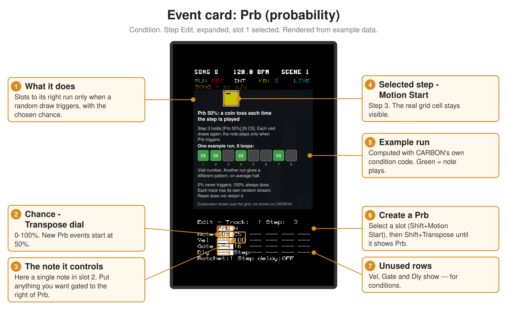

0% never triggers, 100% always does. Each track has its own random stream,
which continues through Reset, track resets and song loads, and is seeded
differently at each power-on. Editing and Magic do not change it.

Example: a note in slot 1, Prb 25% in slot 2, then an accent note and a CC
in slots 3 and 4. The first note always plays; the accent and the CC play
together, about one time in four.

*** Euc: Euclidean loops

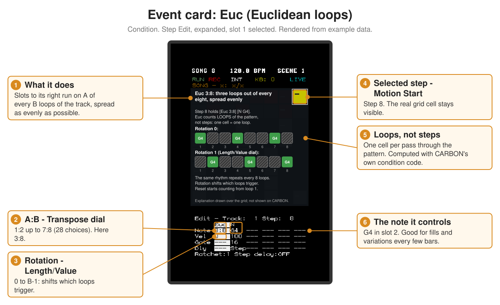

Euc A:B triggers on A of every B *loops* of the track's motion window,
spread as evenly as possible. It counts loops, not steps: Euc 1:4 on a
fill step plays the fill every fourth time through the pattern. There are
28 pairs from 1:2 to 7:8. Rotation shifts which loops trigger. This is
separate from Euclidean density, which thins out steps (see
[[*Euclidean density and rotation][Euclidean density and rotation]]).

*** Pre and !Pr: answer the previous result

- *Pre* lets the slots to its right run only if a condition *triggered*
  the last time this track checked conditions.
- *!Pr* is the opposite: the slots to its right run only if *nothing
  triggered* last time.

Example: a phrase behind Prb 50% on one step; on a later step, an answer
behind Pre, and an alternative behind !Pr. If no other condition is
checked in between, either the answer or the alternative plays, depending
on whether the first phrase played.

Exact rule: "last time" means the most recent visit on this track that
checked at least one Prb, Euc or Pre. It counts as triggered if any of them
triggered, even if a later one failed. Scn and !Pr never count. Pre and
!Pr read the result from before the current visit, not from conditions to
their left on the same step. Reset clears the result to "not triggered".

*** Scn: scene gate

Scn lets the slots to its right run only in the scenes you choose. Select a
Scn slot: buttons 1--6 then toggle scenes directly (no Scene button needed),
with matching LEDs. The three-character field shows pairs of scenes as
bars, and the title spells out the mask, e.g. =Scn: 1-3--6 Keys toggle=.
New Scn events allow all scenes. Scn uses no randomness and does not count
for Pre/!Pr. Combine Scn then Prb for a chance only in some scenes.

While a Scn slot is selected, buttons 1--6 do not select tracks or scenes.
Leaving the slot or Step Edit restores normal button behaviour. More:
[[file:SCENE-GATES.org][scene gates]].

*** Condition details

- Steps masked by the pattern do not check conditions. Muted or Live
  control sources still check them for Bias and CCi purposes.
- Reset, MIDI Start, song load and a track reset clear the previous result
  and restart Euc loop counting; the random stream continues. Stop and
  Continue keep everything. Scene changes keep condition state.
- Euc loop counting advances when the motion window wraps, including in
  reverse; an actual change of direction counts as one loop. Editing the
  motion window does not.

** Messages out: CC and Program Change

- *CC* sends a MIDI controller value on the step.
- *PC* sends a Program Change (1--128) on the step, on both of the track's
  outputs, as a raw MIDI message unaffected by scale or transpose.

Each scene can also send a Program Change when it becomes active, for each
track's output A and B. Find =Program A= and =Program B= for Scenes 1--6 at
the end of the MIDI menu (after =MIDI Autolive=). =Off= sends nothing. The
program is sent before the scene's first notes; CV outputs do not send it.

** Shaping events

*** CCi: steer another track

CCi changes a setting of the tracks that use *this* track as Bias Track,
without sending anything to MIDI or CV. The value holds until another CCi
changes it, and clears on song load, scene change and transport reset. It
never changes the saved settings of the target track.

| CCi | Changes         | CCi | Changes             |
|-----+-----------------+-----+---------------------|
|  16 | Step length     |  25 | Arp type            |
|  17 | Transpose       |  26 | Arp speed           |
|  18 | Mute            |  27 | Arp gate time       |
|  19 | Motion start    |  28 | Euclidean density   |
|  20 | Motion length   |  29 | Euclidean rotation  |
|  21 | Direction       |  34 | Glide duration      |
|  22 | Gate time       |  35 | Glide curve         |
|  23 | Pattern type    |     |                     |
|  24 | Arp enable      |     |                     |

Selecting a CCi number briefly shows its name; turning its value shows the
meaning (e.g. density shows hits per length of the first target). A source
track may also hold notes; they keep transposing the targets as usual.

Example: on Track 1 set Bias Track to Track 3. On Track 3, add CCi 28
events to change Track 1's Euclidean density from step to step. No MIDI
loopback cable is needed (and loopback causes doubled notes).

*** Hrm and Inv: harmony and voicing

Hrm and Inv are most useful on a Bias source: one track holds the harmony
changes, the others follow.

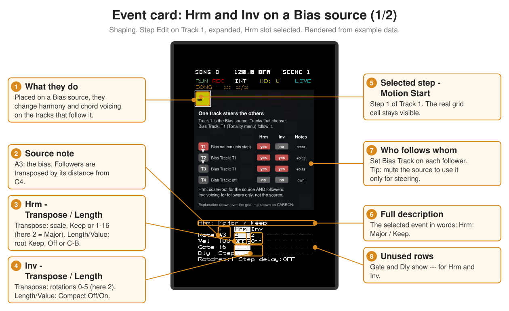

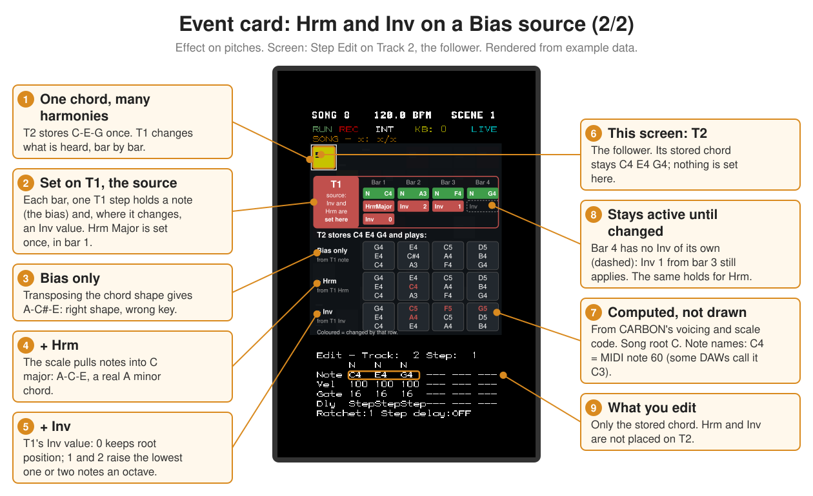

*Hrm* sets a scale and optionally the shared root:
- Transpose: Keep or one of the 16 scales (Chromatic is 1; there is no
  separate "off"). Length/Value: root Keep, Off or C to B.
- The scale applies to the Hrm's own track *and* every track that follows it
  as Bias Track. A named root applies to *all* melodic tracks in the scene.
- The title line spells it out, e.g. =Hrm: Major / D=.

*Inv* re-voices chords on the tracks that follow its track (not its own):
- Transpose: 0 to 5 rotations. Each rotation moves the lowest note up an
  octave above the rest: C-E-G becomes E-G-C, then G-C-E.
- Length/Value: Compact On keeps the new bass and pulls the other notes down
  to within an octave above it. Compact is octave compression, not voice
  leading.
- Inv works on any group of notes; it does not recognise chords or scales.
  Live input, drum tracks and arp tracks are not re-voiced.

Both hold until changed. They clear on song load, scene change and transport
reset (Stop/Continue keep them). They never change the stored notes or the
saved settings. Muted sources still steer their followers, so a muted track
can be a pure "harmony track".

Ideas:
- Verse and chorus from one chord pattern: Inv 0 / Compact On for the
  verse, Compact Off for the open chorus voicing.
- A key change for the whole song from one step: =Hrm: Keep / D=.

*** Hrm details

- When several tracks request a root on the same step, the lowest-numbered
  track wins; within a track, the last slot wins. Keep never competes.
- Scale changes apply in track and slot order; the last one wins.
- A root selects the allowed notes; it is not an extra transpose. Notes that
  are already sounding keep their pitch until released.
- Root Off selects the original scale behaviour without a named root.

*** Gli: glide

Gli makes the notes to its *right* on the same step glide from the previous
note. Transpose sets the glide time (Off, 1/128 to 1/1, independent of step
length); Length/Value sets the curve (64 linear, lower = slow start, higher
= fast start). A later Gli on the step changes glide for slots after it.

- On CV, glide is a real pitch ramp with the chosen curve (mono pitch CV
  only).
- On MIDI, CARBON sends portamento time (CC5) and portamento on (CC65)
  before the note; how it sounds depends on the synth, and the curve is
  ignored. Glide Off sends CC65 = 0.
- For a track-wide glide, use CCi 34 (time) and 35 (curve) from a Bias
  source. To glide an arpeggio, use these CCi from another track; Gli on
  the arp's own input step is ignored.
- Use monophonic lines and give each gliding track its own destination.
  When tracks share a MIDI channel or CV output, the lower-numbered track
  controls glide.

* Track and scene settings

** Roots and in-scale transposition

Tonality has a *Song Root* (Off or C to B), and each scene uses the song
root or its own (Off or C to B). Shift+Tonality opens Swing, followed by
the roots. With a named root, transposition moves notes within the scale at
that root; Off keeps the original scale behaviour. Root changes affect new
notes; sounding notes keep their pitch. Drum tracks are not affected.

** Euclidean density and rotation

Every track in every scene has a Euclidean density and rotation. Density
sets how many positions of the motion window are active; rotation moves
them around the window.

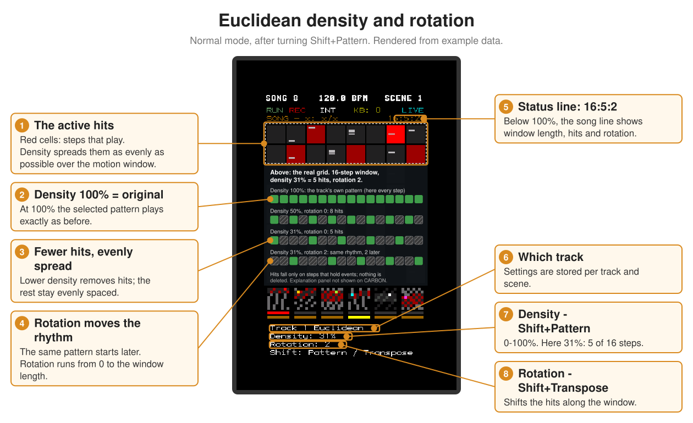

- In normal mode: *Shift+Pattern* changes density, *Shift+Transpose*
  changes rotation. A temporary display shows the values.
- At 100% density, the selected pattern plays as before. Below 100%, the
  Euclidean pattern replaces it as a mask on the stored steps. Nothing is
  deleted, and empty steps stay empty.
- Density is a percentage, so on short windows nearby values can give the
  same pattern.

** Bar-relative step lengths

Step Length also offers =1/3=, =1/5=, =1/7=, =1/9=, =1/11= and =1/13=:
that many steps per 4/4 bar. =1/5= puts five steps in one bar, with any
remainder spread so the bar never drifts. They work with swing, gate,
ratchets, delays, scene changes and external clock. They are not offered
for Arp Speed.

** 16 PPQ clock output

The clock-output rate list includes =16 PPQ= (after =24 PPQ=), for CV/gate
and the other clock outputs.

* Arpeggiator

** Ordinary arp

Arp Type, Speed and Gate work as before. A sequenced note feeds the arp for
its stored length times Track Gate, so use longer notes for a sustained
arpeggio; a longer Arp Gate alone does not hold the input longer. Note
delays and ratchets are ignored for arp input. Humanize can vary arp
velocity and timing.

** Chord mode

Turn Arp Speed past =1/1= to =Chord=. Each step's notes then trigger up to
four simultaneous pitches. Use a polyphonic MIDI destination (mono CV
cannot play a chord).

With one input note, the arp range selects the voicing. In C major from C4:

| Range | Up and most types | Down, Down-High |
|-------+-------------------+-----------------|
|     1 | C4 E4 G4 C5       | C4 G3 E3 C3     |
|     2 | C4 G4 C5 G5       | C4 G3 C3 G2     |
|     3 | C4 G4 C5 C6       | C4 G3 C3 C2     |
|     4 | C4 C5 C6 C7       | C4 C3 C2 C1     |

Thirds and fifths follow the current scale and root: D in C major gives
D F A D. With several input notes, Chord takes the first four distinct
pitches of the selected arp program.

- The first note sets velocity; length is the step length times Track Gate.
  Note lengths, delays, ratchets and Arp Gate are ignored.
- Chord is triggered by the sequencer only, not by held keys. Inv, Gli and
  Humanize do not apply to generated chords.
- In Straight mode Chord follows 1/1 and waits for the next bar. CC26 and
  CCi26 cannot select Chord.

More: [[file:ARP-CHORD.org][Chord details]].

* Performance tools

These tools make live changes safer. They limit the risk of picking a note,
transposition or step subdivision that breaks the groove, by offering only
musically safe choices and by applying changes on the next bar.

** Straight timing

Clock menu, *Perform Grid: Straight*. While on, manual Step Length and Arp
Speed changes only offer 1/32, 1/16, 1/8, 1/4, 1/2 and 1/1 (and Chord),
and while running they wait for the next bar. Turning back to the stored
value cancels a waiting change. Stop, Reset, scene and song changes cancel
waiting changes. The setting is Off at power-on and not saved.

Only manual changes are protected: MIDI Remote, CCi, delays, ratchets and
swing can still produce other timings.

** Pitch ladder

Clock menu, *Perform Pitch*: Off, Octaves or Octaves+5ths. Manual
Transpose then steps along octaves (or octaves and fifths) from each
track's current transpose, waiting for the next bar while running. Several
selected tracks keep their own offsets. Off at power-on and not saved;
Bias notes, CCi17 and MIDI Remote are not restricted.

** Waiting values

=STR= (Straight) or =PIT= (pitch ladder) at the start of the status line
shows protection is on; =*= means a change is waiting for the selected
track. The track readout shows the waiting value with =>=, e.g. =Tran:>+7=
or =Step:>1/4=.

** Snapshot

The snapshot keeps a copy of the whole song in RAM, with the current scene,
offsets, harmony and other temporary controls.

- *Capture*: hold Clock first, then press Record.
- *Recall*: hold Clock first, then press Load. While running, recall
  happens at the next bar; stopped, immediately.

Both are also at the end of the Clock menu. Recall restarts all tracks at
their motion start and releases sounding notes first. It does not save to
flash or resend Program Changes. Loading or clearing a song discards the
snapshot; power-off loses it. Not available while recording.

** Undo

Hold Clock first, then press Run/Stop to undo the last editing operation
(at the next bar while running). Undo points are made by clearing, scene
copy, Magic, Song Edit, recording, and by each visit to a step in Step
Edit. There is one level of undo; repeating it restores the same point.
Undo works in RAM only: save afterwards to keep the result. Details:
[[file:UNDO.org][undo]].

** Humanize

At the end of the Clock menu, per track and not saved with the song:

| Entry       | Range       | Meaning                               |
|-------------+-------------+---------------------------------------|
| Humanize    | Off / On    | Enable for this track                 |
| Vel Chance  | 0..100%     | Chance of velocity variation per note |
| Vel +/-     | 0..32       | Largest velocity change               |
| Gate Chance | 0..100%     | Chance of length variation per note   |
| Gate +/-    | 0..100%     | Largest length change, in percent     |
| Late Chance | 0..100%     | Chance of delaying a note group       |
| Late Max    | 0..24 ticks | Largest extra delay                   |

Small changes are more likely than large ones. Notes on the same step move
together in time. Notes are only ever delayed, never early. For the arp,
only velocity and lateness apply, and a late note ends at its normal time
(very late notes can disappear, which can thin a pattern musically). A
good start: Late Chance 25%, Late Max 2 or 3 ticks. More: [[file:HUMANIZE.org][Humanize details]].

* External MIDI control

With *MIDI Rmt Ctrl* enabled, CARBON accepts these extra controllers.
Channel 10 addresses the selected tracks; channels 11--16 address Tracks
1--6.

| CC | Controls                                                |
|----+---------------------------------------------------------|
| 28 | Euclidean density (0--127 = 0--100%)                    |
| 29 | Euclidean rotation (across the motion length)           |
| 30 | Harmony scale: 0 Keep, 1 Chromatic ... 16 Seven Chord   |
| 31 | Shared root: 0 Keep, 1 Off, 2 C ... 13 B (any channel)  |
| 32 | Inversion rotations 0--5                                |
| 33 | Compact: 0--63 Off, 64--127 On                          |

CC 28 and 29 change stored scene settings (saving keeps them). CC 30--33
are temporary like Hrm and Inv events, and do not pass on to Bias
followers. Values for CC 30--33 are choices, not proportional. Send CC 30
then CC 31 before the note they should affect.

| Value | Scale      | Value | Scale       |
|-------+------------+-------+-------------|
|     1 | Chromatic  |     9 | Phrygian    |
|     2 | Major      |    10 | Lydian      |
|     3 | Nat Minor  |    11 | Mixolydian  |
|     4 | Har Minor  |    12 | Locrian     |
|     5 | Dorian     |    13 | Min Pent    |
|     6 | Whole      |    14 | Blues       |
|     7 | Pentatonic |    15 | Half Dim    |
|     8 | Diminished |    16 | Seven Chord |

Prefer stepped automation: dense continuous streams work but make the
display flicker.

* Compatibility and storage

- Song size stays 20480 bytes, but songs using new events or settings are
  not backward compatible. Keep originals for older firmware.
- Saved songs contain events and base settings. Temporary states (CCi, Hrm,
  Inv and glide overrides, condition history, snapshot, undo, Humanize and
  the performance modes) are not saved.
- Host tools: see the [[file:tools/carbon-backup/README.md][host-tool guide]] for backup, JSON editing and
  upload, and which song formats each tool supports. After uploading a song,
  LOAD it; do not SAVE the old RAM song over it.
- MIDI Remote CC16 covers all step lengths; CC26 keeps the original arp
  speeds. Existing automation values may need adjusting.

* Testing status

The firmware is used on one CARBON (LCD A) with Bitwig, MIDI synths and
CV/gate. The features in this guide have been tried on that hardware and
are covered by automated host tests, but not every combination, device or
timing situation has been tested. Practical feedback is welcome; see the
[[file:RELEASE-CHECKLIST.org][release checklist]] for what is checked before a release.

* Further reading

- [[file:CLOCK-HELP.org][Menu and overview controls]]
- [[file:SCENE-GATES.org][Scene gates]], [[file:UNDO.org][Undo]], [[file:HUMANIZE.org][Humanize]], [[file:ARP-CHORD.org][Arp Chord]]
- [[file:tools/carbon-backup/README.md][Host tools]], [[file:BUILDING.org][Building]]
- [[file:tools/screenshots/README.org][How the images in this guide are made]]
